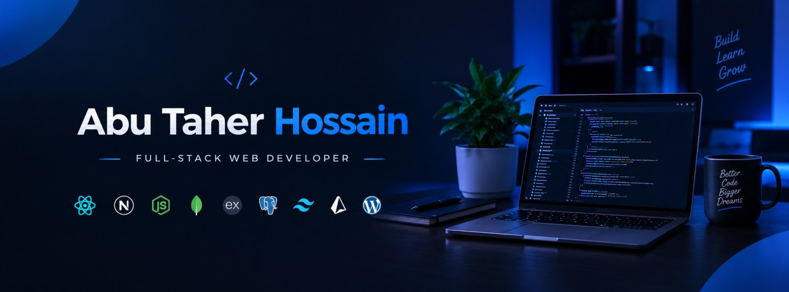

  

<h1 align="center">Hi 👋, I'm Abu Taher Hossain</h1>
<h3 align="center">Full-Stack Web Developer</h3>

  

- 👋 Hi, I’m **@Taher027**
- 💻 Full-stack developer working with React, Next.js and Node. I build web apps and care about the small details.
- 🖥️ Frontend: **React.js, Next.js, TypeScript, Tailwind CSS**
- 🗄️ Backend: **Express.js, MongoDB, Mongoose, PostgreSQL, Prisma, Redis, JWT**
- 🌱 I’m currently learning **Docker** and **AI Implementations**
- 🤖 I use AI tools to speed up my work, but I review and understand every line I ship
- 👯 I’m looking to collaborate on **GitHub**
- 🎬 Fun fact: I love **movies, traveling, and cricket**
- 📫 Reach me: [abutaherh27@gmail.com](mailto:abutaherh27@gmail.com)

 

## 🌐 FOLLOW ME ON SOCIALS:
---

  
  
  
  

 

## 🛠️ TECHNOLOGY STACK:
---

**Languages:**

  

**CSS Frameworks & Libraries:**

  

**JavaScript Frameworks & Libraries:**

  

**Database & ORM/ODM:**

  
  

**Authentication:**

  

**Deployment Platform:**

  

**Tools & Technologies:**

  

**Currently Learning:**

  

 

## 📊 GITHUB STATS:
---

  
  

